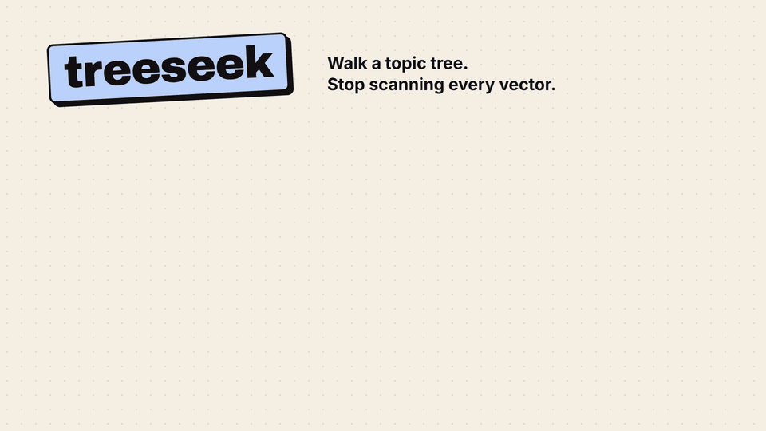
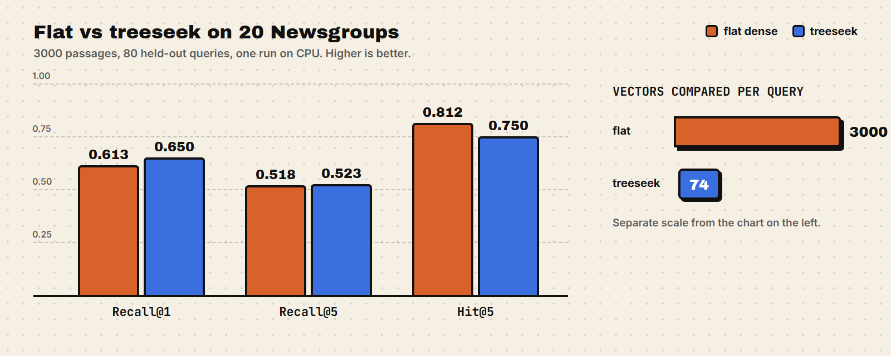
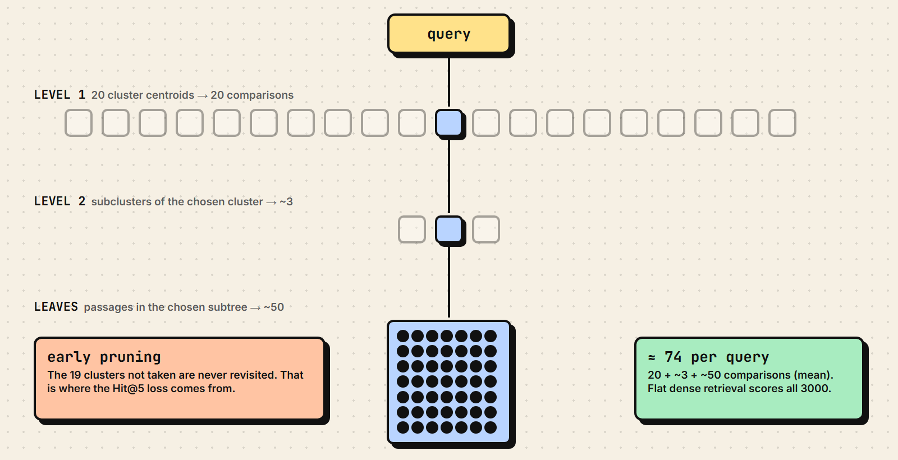

# treeseek

**Retrieval that walks a topic tree instead of scanning every vector: 74 comparisons per query instead of 3000, same top-1 accuracy.**


<a href="assets/treeseek.mp4"></a>

<sub>12 s, no sound. Click for the MP4.</sub>

treeseek is a measured comparison of hierarchical navigation retrieval against flat dense retrieval. The query descends a two-level k-means tree and only scores the passages in the branch it picks. It costs 40x fewer comparisons, and the price is visible in the numbers: a branch that isn't taken is never revisited.

| retriever | Recall@1 | Recall@5 | Hit@5 | vectors compared per query |
|---|---:|---:|---:|---:|
| flat | 0.613 | 0.518 | **0.812** | 3000 |
| **treeseek (nav)** | **0.650** | **0.523** | 0.750 | **74** |



One run on CPU. Full numbers, per-query analysis and build cost are in [RESULTS.md](RESULTS.md).

*Formerly `nav-rag`.*

## How it works



k-means groups the embeddings into a two-level tree: root, 20 top clusters, 61 subclusters, then passages (mean subtree size 49). The tree is unsupervised and never sees newsgroup labels. `flat` scores all 3000 passage vectors. `nav` scores the 20 top centroids, descends into the best one, scores that cluster's subcluster centroids, descends again, and returns top-k from that subtree only.

Centroids are means of unit vectors, so one dot product against a centroid equals the mean member cosine exactly. Each branch decision costs one comparison.

## Quickstart

```sh
python -m pip install -r requirements.txt
python run.py --build
python run.py --eval --retriever both
python -m pytest
```

The first `--build` downloads the 20 Newsgroups corpus (via sklearn) and the all-MiniLM-L6-v2 model (Hugging Face, about 90 MB), embeds 3000 passages and builds the tree in about 66 s on CPU. `--eval` writes `results/results.csv` and `results/summary.json` and prints the table. `--retriever` takes `flat`, `nav` or `both`.

Windows note: torch DLLs have to initialize before scipy loads its BLAS, so `run.py` imports torch first. Do the same if you import the modules from your own entry point.

## Corpus and method

- Corpus: 3000 passages from the 20 Newsgroups train split, 150 per topic, with headers, footers and quotes removed.
- Queries: 80 subject lines from held-out test documents, 4 per topic. No query text appears in the index.
- Embeddings: all-MiniLM-L6-v2 on CPU, L2-normalized. A TF-IDF plus SVD fallback exists; the encoder actually used is recorded in `data/meta.json`.
- Relevance: every passage from the query's topic counts as relevant. Metric definitions are in [DECISIONS.md](DECISIONS.md).

## Where it fails: early pruning

Hit@5 is where nav loses. Flat finds at least one on-topic passage in the top 5 for 65 of 80 queries; nav does it for 60. 57 are solved by both, 3 only by nav and 8 only by flat, and all 8 flat-only hits come from pruned branches.

A concrete case: the query "Age of Reason Was: Who has read Rushdie's" (topic alt.atheism). Flat returns two alt.atheism passages in its top 5. Nav picked subcluster 35 under top cluster 11, a mixed subtree of sci.med, rec.sport.baseball, talk.politics.misc and talk.religion.misc. Since nav only searches that subtree, no alt.atheism passage can be reached at any rank. Another one: "Best Radar Detector - VALENTINE-1?" (rec.autos), where nav went into a misc.forsale and sci.electronics subtree. Close in meaning, wrong topic.

## Limitations

- This is a zero-training approximation of a trained model. treeseek scores k-means centroids; DecisionRAG trains a hierarchical decision model over 2.68M paragraphs and reports gains over a dense retriever plus an 8B reranker. The two aren't comparable.
- The corpus is small (3000 passages) and its clean topic structure favors clustering. Queries are short subject lines, not natural questions, and relevance is topic-level.
- Greedy descent can't be undone: no backtracking, no beam, no sibling expansion. One wrong centroid comparison at level 1 removes about 1/20 of the corpus, which accounts for all 8 flat-only failures above.
- Nav returns at most k passages from one subtree. A subtree smaller than k returns fewer results.
- Open questions: whether pruning losses grow with tree depth or corpus size, and whether a trained decision model would avoid these branch errors. What this run does show: on a small structured corpus, plain hierarchical navigation matches flat dense retrieval on top-rank topic accuracy at 1/40 of the comparison cost, and loses about 6 points of Hit@5 to irreversible pruning.

## Background

treeseek is based on the navigation idea in "DecisionRAG: Retriever-Free Retrieval via Hierarchical Decision Models" (arXiv 2610.35868, Cornell and ASAPP). Branches are scored by mean member similarity of k-means centroids, not by the paper's trained hierarchical decision model. It is not a reproduction, and none of the numbers here say anything about the paper's numbers.

## Repository layout

| Path | What it holds |
| --- | --- |
| `run.py` | CLI: `--build`, `--eval`, `--retriever flat\|nav\|both` |
| `src/corpus.py` | 20 Newsgroups passages and held-out subject queries |
| `src/embeddings.py` | MiniLM encoder with LSA fallback |
| `src/tree.py` | two-level k-means tree, centroid persistence |
| `src/retrieval.py` | flat and nav retrievers, one interface |
| `src/eval.py` | metrics: Recall@1, Recall@5, Hit@5 |
| `data/` | built artifacts (corpus, queries, embeddings, tree, meta) |
| `results/` | `results.csv`, `summary.json` |
| `tests/` | offline unit tests on synthetic vectors |
| `assets/` | demo video, GIF and diagrams |

## Citation

Source paper:

```bibtex
@misc{decisionrag2026,
  title         = {DecisionRAG: Retriever-Free Retrieval via Hierarchical Decision Models},
  year          = {2026},
  eprint        = {2610.35868},
  archivePrefix = {arXiv},
  url           = {https://arxiv.org/abs/2610.35868},
  note          = {Cornell University and ASAPP}
}
```

This repository:

```bibtex
@misc{treeseek2026,
  title  = {treeseek: hierarchical navigation retrieval vs flat dense retrieval on 20 Newsgroups},
  author = {Gjusev},
  year   = {2026},
  url    = {https://github.com/Gjusev/treeseek},
  note   = {Zero-training approximation of the navigation idea in arXiv:2610.35868, not a reproduction}
}
```

MIT licensed, see [LICENSE](LICENSE).
